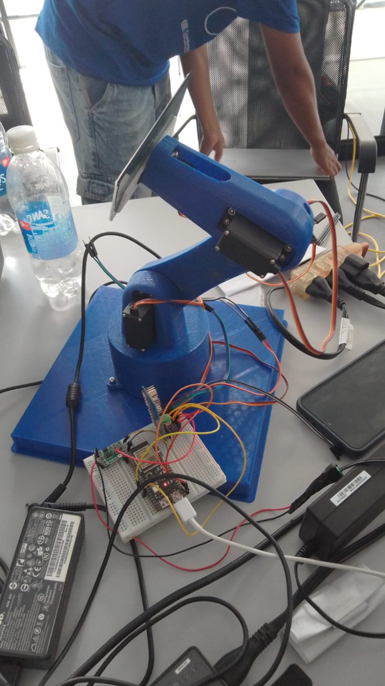
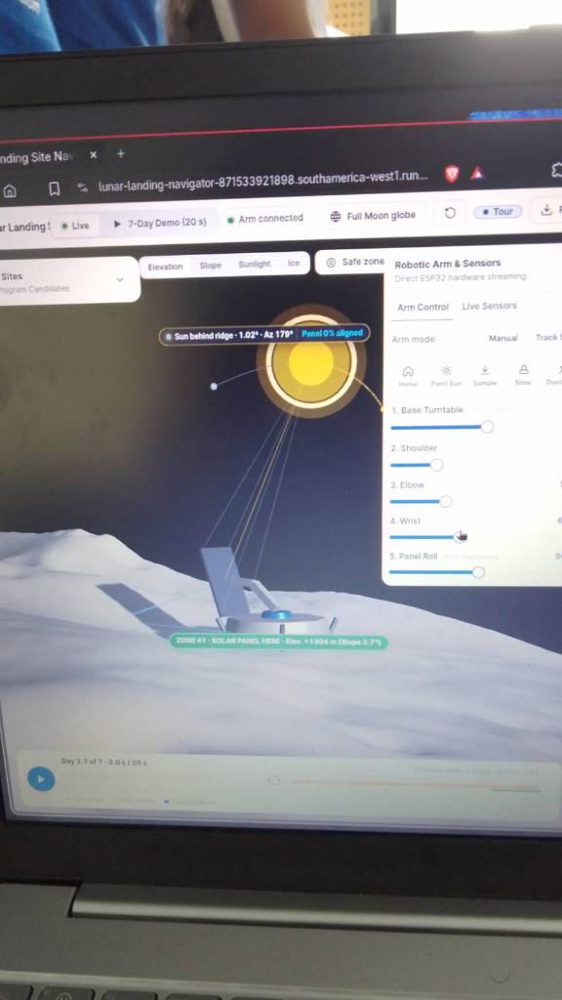
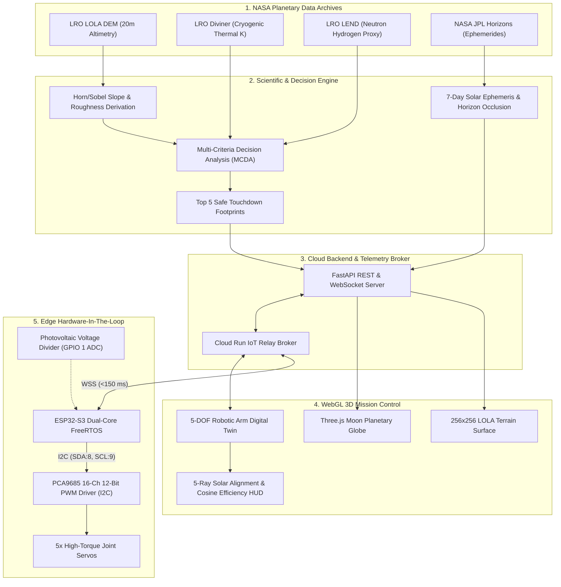

# Lunar Landing Site Navigator
### Autonomous Artemis Polar Landing Site Selection, WebGL 3D Digital Twin & 5-DOF Solar-Tracking Teleoperation
**NASA International Space Apps Challenge 2026 | Team 01 (`eq01`)**

[](https://fastapi.tiangolo.com)
[](https://threejs.org)
[](https://www.espressif.com)
[](https://lunar-landing-navigator-871533921898.southamerica-west1.run.app/dashboard)
[](LICENSE)

---

## 🚀 Live Cloud Deployment

Explore the interactive Mission Control dashboard running in production on Google Cloud Run:

🔗 **[https://lunar-landing-navigator-871533921898.southamerica-west1.run.app/dashboard](https://lunar-landing-navigator-871533921898.southamerica-west1.run.app/dashboard)**

*Features live WebSocket hardware streaming, 3D lunar terrain mesh, real-time inverse kinematics teleoperation, and 7-day solar transit simulation.*

---

## 📸 System Showcase: Physical Hardware & WebGL Digital Twin

| Physical 3D-Printed Robotic Arm (HIL) | WebGL 3D Mission Control Digital Twin |
|:---:|:---:|
|  |  |
| **Physical 5-DOF Articulated Actuator**<br>ESP32-S3 MCU + PCA9685 I2C 12-bit PWM Controller<br>Solar Cell End-Effector with ADC Monitoring | **Three.js Digital Twin & Teleoperation**<br>LRO LOLA 256×256 Terrain Mesh & Ray-Cast Shadows<br>5-Ray Solar Alignment Frustum & Real-Time Joint Telemetry |

> 📁 **3D CAD Printable Models Included:** Full 3D printable STL files (`.stl`) for the robotic arm assembly, motor brackets, hinge unions, and turntable base are available in [`assets/models/cad_3d/`](assets/models/cad_3d/).

---

## 1. Executive Summary

The lunar south pole is humanity's gateway for a sustained presence on the Moon under NASA's **Artemis program**. However, polar regions present severe operational hazards:
- **Steep Topography & Impact Hazards**: Jagged crater rims, hazardous slopes, and micro-roughness threaten lander stability upon touchdown.
- **Permanently Shadowed Regions (PSRs)**: Deep craters exist in eternal darkness at cryogenic temperatures ($<40\text{ K}$), harboring vital water ice but posing extreme survival risks.
- **Extreme Grazing Solar Angles**: The polar Sun grazes the horizon at elevations of only $0.8^\circ \dots 1.5^\circ$. Horizontal solar panels capture almost negligible sunlight ($\sin(1.1^\circ) \approx 0.019$), resulting in severe power starvation.

### Our Solution: Lunar Landing Site Navigator
An integrated aerospace platform that fuses orbital planetary science with ground robotics:

1. **Multi-Criteria Decision Analysis (MCDA)**: Ingests NASA Lunar Reconnaissance Orbiter (**LRO LOLA** altimetry, **Diviner** thermal brightness, **LEND** neutron epithermal hydrogen, and **JPL Horizons** celestial mechanics) to quantitatively rank Artemis landing regions and delineate the **Top 5 Safe Touchdown Footprints** ($100\text{ m}$ radius, slope $<5^\circ$, surface roughness $<0.15\text{ m}$).
2. **Interactive 3D WebGL Digital Twin**: Seamlessly zooms from a photorealistic 3D Moon globe down to a high-resolution $256\times 256$ LOLA terrain mesh. Features parabolic lander relocation, realistic polar grazing illumination, and dynamic crater shadow casting.
3. **5-DOF Robotic Arm with Solar Panel End-Effector**: Real-time closed-form inverse kinematics tracks the low-elevation Sun with a 5-ray visual alignment frustum, delivering a **50.1× energy multiplication factor** ($15,795\text{ Wh}$ vs $315\text{ Wh}$) over a fixed horizontal panel across a 7-day polar mission window.
4. **Hardware-In-The-Loop (HIL) Dual-Core Teleoperation**: ESP32-S3 microcontroller running FreeRTOS with PCA9685 I2C 12-bit PWM servo control, 16× oversampled ADC solar voltage sensing, and sub-150 ms bidirectional WebSocket synchronization over Google Cloud Run.

---

## 2. System Architecture



---

## 3. Artemis Portfolio & Safe Landing Footprints

### Evaluated Artemis South Polar Sites
Quantitative multi-criteria assessment across candidate NASA Artemis landing regions:

| Candidate Site | Latitude | Longitude | Elevation | Mean Slope | Sun Illum. | DTE Visibility | Composite Score | Role in Artemis Architecture |
|---|:---:|:---:|:---:|:---:|:---:|:---:|:---:|---|
| **1. Connecting Ridge** | 89.44° S | 222.05° E | +1,139 m | 8.5° | 50.8% | 9.8% | **42.2 / 100** | **Primary Balanced Landing Site** |
| **2. North Peak** | 89.15° S | 295.40° E | +1,960 m | 10.2° | **100.0%** | 10.8% | **45.7 / 100** | Tactical Continuous Sun Contingency |
| **3. Malapert Mountain** | 85.99° S | 002.94° E | **+4,980 m** | 12.8° | 92.5% | **88.4%** | **52.4 / 100** | High-Elevation DTE Communications Base |
| **4. Faustini Rim A** | 87.12° S | 084.50° E | -1,420 m | 11.4° | 32.1% | 4.5% | **33.0 / 100** | Cryogenic PSR Water-Ice Extraction Zone |

### Top 5 Safe Touchdown Footprints on Connecting Ridge (100 m Radius)
Within the primary landing site, our algorithm identifies five micro-zones that strictly minimize landing hazards:

| Rank | Elevation | Max Slope | Mean Slope | Surface Roughness | Distance to PSR | Safety Score | Classification |
|:---:|:---:|:---:|:---:|:---:|:---:|:---:|---|
| **#1** | **+1,304 m** | **2.73°** | 1.08° | **0.111 m** | 5.61 km | **92.71** | **PRIME TOUCHDOWN FOOTPRINT** |
| **#2** | +1,623 m | 2.53° | 1.19° | 0.127 m | 2.62 km | **92.57** | Alternate Backup Landing Zone |
| **#3** | +1,653 m | 4.14° | 1.36° | 0.136 m | 3.94 km | **91.22** | High-Relief Alternate Footprint |
| **#4** | +864 m | 3.01° | 1.17° | 0.099 m | 5.37 km | **91.17** | Secondary Touchdown Zone |
| **#5** | +862 m | 3.43° | 1.31° | 0.115 m | 5.59 km | **88.49** | Tactical Touchdown Footprint |

---

## 4. The 50.1× Solar Tracking Energy Multiplier

Near the lunar south pole, solar elevation oscillates between $0.8^\circ$ and $1.5^\circ$ above the horizon. 

$$\begin{aligned}
\text{Incident Irradiance on Flat Panel:} \quad & I_{\text{fixed}} = I_0 \cdot \sin(\alpha_{\text{sun}}) \approx 1361 \cdot \sin(1.1^\circ) \approx 26.1\,\text{W/m}^2 \\
\text{Incident Irradiance on Tracked Panel:} \quad & I_{\text{tracked}} = I_0 \cdot \cos(0^\circ) = 1361 \cdot 1.000 = 1361\,\text{W/m}^2
\end{aligned}$$

| Metric | Fixed Horizontal Panel | 5-DOF Active Solar Tracking Arm | Multiplier |
|---|:---:|:---:|:---:|
| **Mean Usable Solar Flux** | $26.1\,\text{W/m}^2$ | **$1,361.0\,\text{W/m}^2$** | **$52.1\times$** |
| **7-Day Total Energy Captured** | **$315\text{ Wh}$** | **$15,795\text{ Wh}$** | **$50.1\times$** |
| **Minimum Battery State of Charge (SoC)** | $0.0\%$ *(Depleted within 18h)* | **$23.8\%$** *(Sustains Cryogenic Heaters)* | **Mission Enabling** |

---

## 5. 5-DOF Kinematics & Anatomical Joint Calibration

The digital twin and physical actuator share a calibrated closed-form inverse kinematics engine. Angles are constrained to safe mechanical limits to prevent joint collisions and servo stall:

| Joint | Servo Function | Range | Home Position | Role & Physical Realization |
|:---:|---|:---:|:---:|---|
| **$j_0$** | **Base Turntable** | $25^\circ \dots 155^\circ$ | $90^\circ$ | Planetary azimuth sweep following polar Sun transit |
| **$j_1$** | **Shoulder Pitch** | $35^\circ \dots 115^\circ$ | $55^\circ$ | Primary elevation arm articulation |
| **$j_2$** | **Elbow Flexion** | $40^\circ \dots 125^\circ$ | $60^\circ$ | Human-like `<` elbow posture preventing kinematic lock |
| **$j_3$** | **Wrist Pitch** | $40^\circ \dots 135^\circ$ | $70^\circ$ | End-effector solar normal tilt alignment |
| **$j_4$** | **Panel Roll** | $30^\circ \dots 150^\circ$ | $90^\circ$ | Fine solar azimuth optimization & anti-torsion |

---

## 6. Hardware-In-The-Loop Specification

- **Microcontroller**: ESP32-S3 (Dual-Core 240 MHz, 16 MB Flash, Native USB-CDC).
- **PWM Controller**: PCA9685 16-Channel 12-bit PWM generator connected via I2C (`SDA = GPIO 8`, `SCL = GPIO 9`).
- **Power Architecture**:
  - Logic Rail: 3.3V / 5V USB-C.
  - Servo Rail: Dedicated external 5V 3A DC regulated supply with common ground.
- **Sensor Inputs**:
  - `GPIO 1`: 12-bit ADC (16× hardware oversampled) reading photovoltaic divider output.
  - `GPIO 4`: DHT22 digital environmental sensor.
- **Firmware Path**: [`firmware/esp32_s3_arm/esp32_s3_arm.ino`](firmware/esp32_s3_arm/esp32_s3_arm.ino).

---

## 7. Quick Start Guide

### Prerequisites
- Python 3.10+ (tested on Python 3.12 / 3.14)
- Modern web browser with WebGL support (Chrome, Edge, Firefox)

### 1. Local Python Setup
```bash
# Clone the repository
git clone https://github.com/your-org/lunar-landing-navigator.git
cd lunar-landing-navigator

# Create virtual environment and install dependencies
python -m venv .venv
# Linux / macOS:
source .venv/bin/activate
# Windows PowerShell:
.\.venv\Scripts\Activate.ps1

pip install -r requirements.txt

# Start FastAPI server
uvicorn src.api.main:app --host 0.0.0.0 --port 8000 --reload
```
Open your browser at: **`http://localhost:8000/dashboard/`**

### 2. Docker Deployment
```bash
# Build Docker image
docker build -t lunar-landing-navigator .

# Run container on port 8080
docker run -p 8080:8080 lunar-landing-navigator
```

### 3. One-Click Google Cloud Run Deployment
```powershell
# Windows PowerShell
.\deploy_gcloud.ps1

# Linux / macOS Bash
./deploy_gcloud.sh
```

### 4. ESP32-S3 Firmware Compilation & Flash
```bash
cd firmware/esp32_s3_arm
arduino-cli compile --fqbn esp32:esp32:esp32s3:CDCOnBoot=cdc,USBMode=hwcdc,FlashMode=dio,PSRAM=disabled esp32_s3_arm.ino
arduino-cli upload -p COM6 --fqbn esp32:esp32:esp32s3:CDCOnBoot=cdc,USBMode=hwcdc,FlashMode=dio,PSRAM=disabled esp32_s3_arm.ino
```

---

## 8. Repository Structure

```
lunar-landing-navigator/
├── assets/
│   ├── hardware/
│   │   └── robotic_arm_physical.png       # Photo of physical 3D-printed robotic arm
│   ├── models/cad_3d/
│   │   ├── lunar_solar_arm_assembly.stl   # Full 3D printable CAD arm assembly
│   │   ├── arm_bracket_chassis.stl        # Main structural bracket
│   │   ├── arm_turntable_base.stl         # Azimuth turntable base mount
│   │   ├── servo_mount_bracket.stl        # High-torque servo mounting plate
│   │   └── joint_hinge_union.stl          # Hinge union linkage
│   └── ui/
│       └── mission_control_dashboard.png  # Photo of Mission Control WebGL UI
├── data/
│   ├── processed/                         # Scientific Parquet & JSON structures (~3.2 MB)
│   │   ├── terrain_3d_mesh.json           # 256x256 LOLA elevation grid
│   │   ├── optimal_landing_sites.json     # MCDA top candidate sites
│   │   ├── mission_timeline_simulation.json # 7-day 168h ephemerides & energy
│   │   └── terrain_metrics_summary.json   # Slope, roughness, and PSR bounds
│   └── raw/                               # Raw DEM ingestion documentation
│       └── README.md
├── docs/
│   ├── ARCHITECTURE.md                    # Detailed pipeline, data flow & WebSocket specs
│   ├── HARDWARE_MANUAL.md                 # ESP32-S3 wiring, PCA9685 I2C map & limits
│   └── SCIENTIFIC_METHODOLOGY.md          # LOLA DEM formulas, MCDA weights & solar physics
├── firmware/
│   └── esp32_s3_arm/
│       ├── esp32_s3_arm.ino               # Dual-core FreeRTOS firmware
│       └── include/config.h               # Hardware pinouts & configuration
├── scripts/
│   ├── inspect_lola_dem.py                # DEM header & raster statistics inspector
│   ├── process_terrain_metrics.py         # Slope & roughness grid calculator
│   ├── synthesize_planetary_layers.py     # MCDA portfolio synthesizer
│   ├── simulate_mission_timeline.py       # 7-day solar ephemeris generator
│   ├── simulate_esp32_hardware.py         # Hardware telemetry emulator
│   └── smoke_test.py                      # Automated health & API integrity check
├── src/
│   ├── api/
│   │   ├── main.py                        # FastAPI REST API & WebSocket endpoints
│   │   └── cloud_relay.py                 # Async WebSocket cloud broker bridge
│   ├── core/
│   │   ├── terrain.py                     # Scientific DEM algorithms
│   │   ├── planetary_science.py           # MCDA evaluation engine
│   │   ├── safety.py                      # Slope & roughness hazard filter
│   │   └── mission.py                     # Solar transit simulation
│   └── dashboard/
│       ├── index.html                     # Mission Control WebGL dashboard
│       ├── css/style.css                  # NASA dark-theme mission styling
│       ├── js/
│       │   ├── app.js                     # State management & UI events
│       │   ├── terrain_view.js            # Three.js 3D globe & surface digital twin
│       │   ├── telemetry.js               # Live WebSocket telemetry handler
│       │   └── simulation.js              # 7-day timeline controls
│       └── vendor/                        # Three.js r128 & OrbitControls
├── .dockerignore
├── .env.example                           # Clean template for broker credentials
├── .gcloudignore
├── .gitignore
├── deploy_gcloud.ps1                      # Windows PowerShell Cloud Run deploy script
├── deploy_gcloud.sh                       # Linux / macOS Cloud Run deploy script
├── Dockerfile                             # Lightweight multi-stage container build
├── LICENSE                                # Permissive MIT License
└── requirements.txt                       # Minimal pinned dependencies
```

---

## 9. NASA Data Citations & Planetary References

1. **NASA Lunar Reconnaissance Orbiter (LRO) - LOLA Science Team**: *Lunar Orbiter Laser Altimeter Digital Elevation Models (LOLA DEM)*, PDS Geosciences Node, NASA Goddard Space Flight Center.
2. **NASA LRO Diviner Lunar Radiometer Experiment**: *Diviner Polar Brightness Temperature & Cold Trap Maps*, UCLA / NASA Jet Propulsion Laboratory.
3. **NASA LRO Lunar Exploration Neutron Detector (LEND)**: *Hydrogen & Epithermal Volatiles in Permanently Shadowed Regions*, Space Research Institute (IKI) / NASA GSFC.
4. **NASA JPL Horizons On-Line Ephemeris System**: *Lunar South Pole Celestial Ephemerides (Sun & Earth position vectors)*, NASA Jet Propulsion Laboratory.
5. **NASA Scientific Visualization Studio (SVS)**: *CGI Moon Kit (Color Maps & Displacement Basemaps)*, NASA Goddard Space Flight Center.

---

## 10. Security & Credentials Notice

This repository strictly adheres to modern security standards:
- **No private API keys, Wi-Fi credentials, or device tokens are committed to source control.**
- All networking configurations use environment variables via `.env` or system environment overrides (see [`.env.example`](.env.example)).
- Microcontroller firmware reads connection configurations from safe definitions or local config headers.
