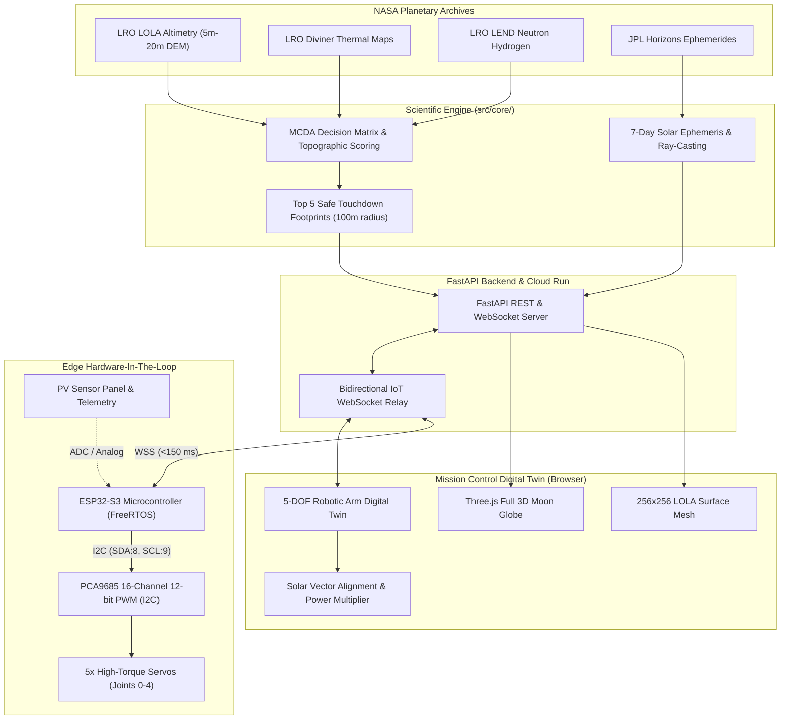

# System Architecture & Technical Pipeline

The **Lunar Landing Site Navigator** integrates high-precision NASA planetary datasets, real-time closed-form inverse kinematics, an interactive WebGL 3D Digital Twin, and an IoT Hardware-In-The-Loop (HIL) robotic arm controller.

---

## 1. High-Level Data Flow

---

## 2. Core Subsystems

### A. Planetary Data Preprocessing & Scientific Analysis
1. **Topographic Assessment**: Evaluates local slopes and bidirectional curvature from LRO LOLA elevation grids. Identifies landing hazards exceeding standard lander thresholds (slope $> 10^\circ$, roughness $> 0.2$ m).
2. **Multi-Criteria Decision Analysis (MCDA)**:
   $$\text{Score} = w_{\text{slope}} \cdot S_{\text{slope}} + w_{\text{illum}} \cdot S_{\text{illum}} + w_{\text{dte}} \cdot S_{\text{dte}} + w_{\text{temp}} \cdot S_{\text{temp}} + w_{\text{ice}} \cdot S_{\text{ice}}$$
   Provides objective, quantitative ranking across candidate Artemis landing regions.
3. **Horizon Masking & Grazing Solar Simulation**: Ray-casts local terrain at sub-degree azimuth steps to detect mountain ridgeline shadows, calculating exact line-of-sight solar visibility during the 7-day lunar polar cycle.

### B. Interactive WebGL Digital Twin (`src/dashboard/`)
- **Macro-to-Micro Planetary Navigation**: High-resolution LROC textured 3D Moon sphere with smooth cinematic zoom down to local landing sites.
- **Dynamic Terrain Rendering**: 256×256 vertex mesh generated directly from LOLA DEM altimetry with grazing directional light casting dynamic shadows across crater rims.
- **5-Ray Alignment Frustum**: Real-time visualization of the solar vector relative to the solar panel's normal vector:
  $$\cos(\theta) = \hat{n}_{\text{panel}} \cdot \hat{s}_{\text{sun}}$$
  Calculates instant cosine-loss efficiency and projected power output in Watts.

### C. Inverse Kinematics (IK) & Anatomical Constraints
To ensure the digital twin matches the physical 3D-printed robotic arm without mechanical collision or servo binding:
- **Turntable Base ($j_0$)**: $25^\circ \le j_0 \le 155^\circ$ (Azimuth tracking; Home: $90^\circ$).
- **Shoulder Pitch ($j_1$)**: $35^\circ \le j_1 \le 115^\circ$ (Elevation lift; Home: $55^\circ$).
- **Elbow Flexion ($j_2$)**: $40^\circ \le j_2 \le 125^\circ$ (Human-like natural elbow angle; Home: $60^\circ$).
- **Wrist Pitch ($j_3$)**: $40^\circ \le j_3 \le 135^\circ$ (Panel tilt; Home: $70^\circ$).
- **Panel Roll ($j_4$)**: $30^\circ \le j_4 \le 150^\circ$ (Fine alignment; Home: $90^\circ$).

### D. IoT WebSocket Cloud Relay & Hardware Teleoperation
- Connects directly to the Google Cloud Run broker over secure TLS WebSockets (`wss://`).
- Bidirectional communication latency is sub-150 ms.
- Dual operating modes:
  - **Live Mode**: Direct real-time bidirectional streaming with the physical ESP32-S3 robotic arm.
  - **Simulation / Demo Mode**: Pre-calculated 7-day accelerated solar transit with automated tracking and landing zone inspection.
